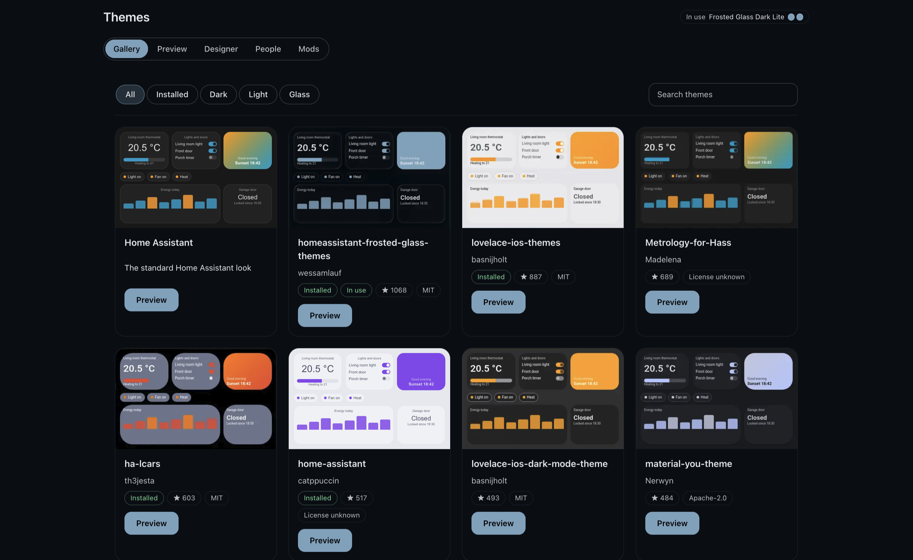
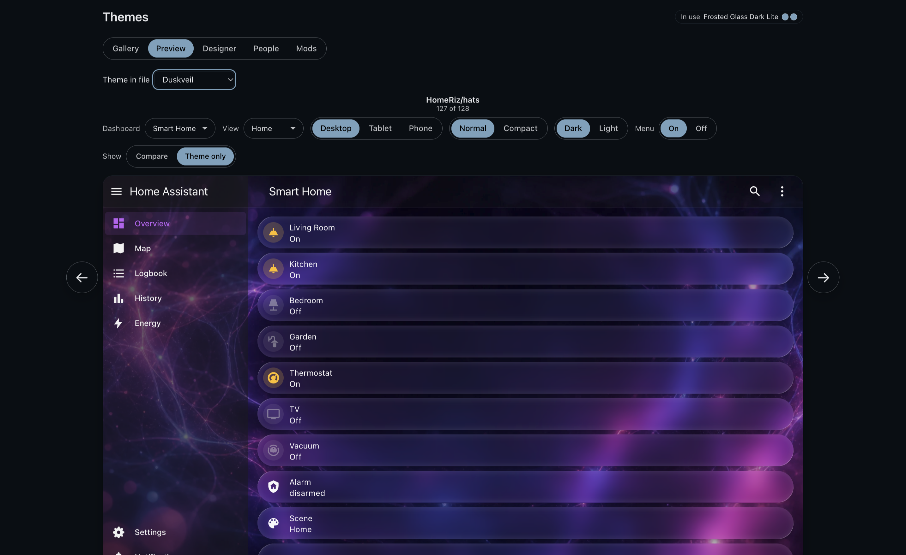
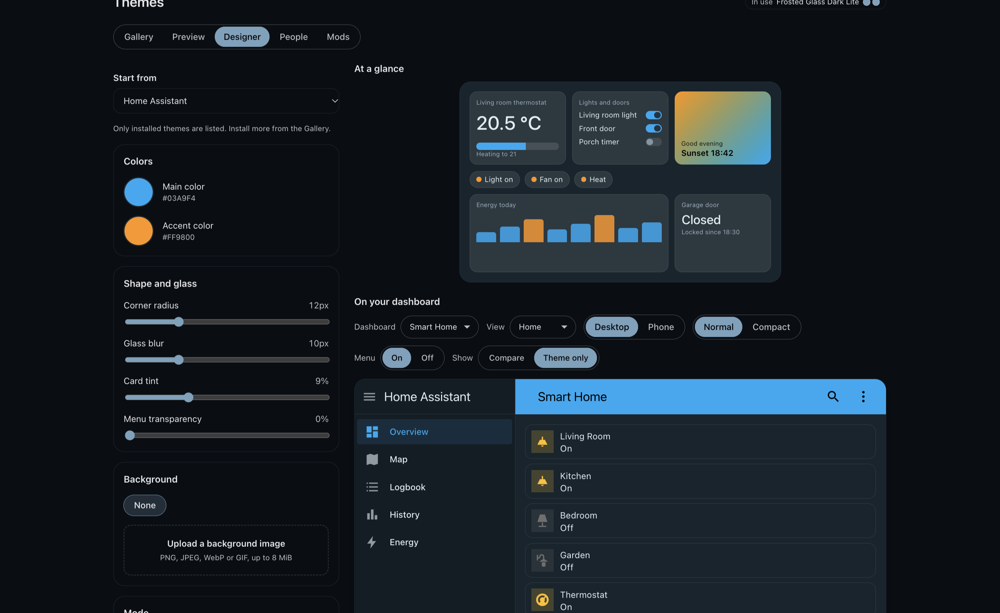
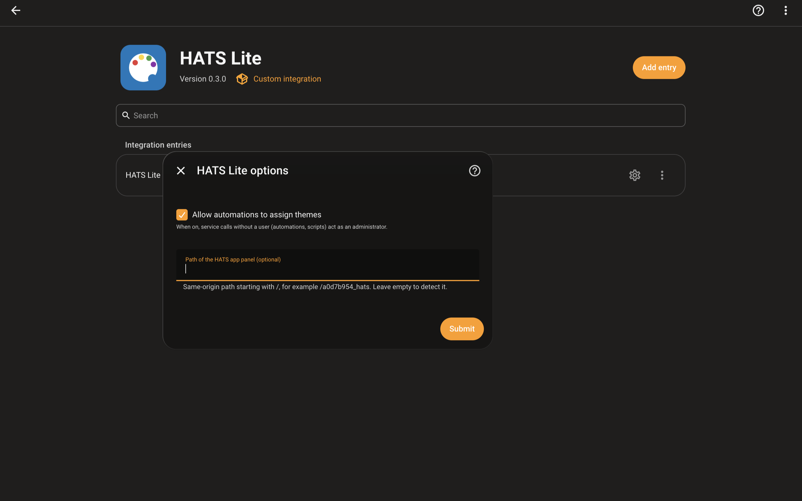

# HATS Lite

HATS Lite is a Home Assistant integration that adds one panel to the sidebar for browsing, previewing and applying themes. It shows a theme on your own dashboard next to the one you use now, and it lets you try a theme with an automatic way back.

## What it does

- **Browse** the theme catalog. If the Marketplace (Home Assistant 2026.11 and newer) or HACS is available the list comes from it, otherwise from the public HACS theme catalog. Every card shows the repository, description, stars and whether the theme is installed.
- **Preview** a theme on your real dashboard. Pick a dashboard and a view, drag the divider to compare the current theme with the candidate, switch between desktop, tablet and phone widths, between normal and compact density, and between dark and light.
- **Apply** a theme that is already installed, or **try** it for 30 seconds.
- **Original HATS themes**: the Gallery includes the 21 original themes of the HATS project. They are not installed by the Marketplace or HACS, so an administrator adds one with the Add to my themes button, which saves a sanitized copy in the themes folder.
- **Design** a simple theme with main and accent color, corner radius, glass blur, card tint and a background image, then save it as a theme file. Uploading a background and saving a theme need an administrator account.

## Screenshots

The Gallery lists themes with a live thumbnail, the repository, stars and license. Preview shows a theme on your own dashboard.





The Designer builds a simple theme from colors, corner radius, glass blur, card tint, menu transparency and a background image.



Once installed, HATS Lite is listed under Settings, Devices and services. Select Configure to open its options.



## The safe try

Trying a theme applies it, and 30 seconds later a large confirmation appears with Keep and Revert buttons and a visible countdown. If you do nothing for 5 more seconds the previous theme comes back. The confirmation does not use the theme being tried, so it stays readable even when the theme is broken.

The server keeps the trial and reverts it by itself. If you close the tab or lose the connection, the previous theme is restored the next time Home Assistant opens in that browser.

## Requirements

- Home Assistant 2025.7.0 or newer.
- The Marketplace (Home Assistant 2026.11 and newer) or HACS is optional. Without one of them the panel can preview any theme in the public catalog, but a theme can only be applied after it is installed in your `themes` folder. With one of them, administrators can install and remove catalog themes from the panel. The Marketplace asks you to accept its warning once before the panel can install anything.
- `frontend: themes:` configured in Home Assistant, as for any theme.

## Installation

HATS Lite is a custom integration. Install it with the Marketplace or with HACS, then add it to Home Assistant. Both ways end the same: a Themes entry appears in the sidebar.

### With the Marketplace (Home Assistant 2026.11 and newer)

1. Go to Settings, Marketplace and select Add from link.
2. Enter `HomeRiz/hats-lite`, choose the type Integration if asked, and select Add.
3. Select HATS Lite in the list and install it. The first time, the Marketplace asks you to accept its warning.
4. Restart Home Assistant.
5. Go to Settings, Devices and services, select Add integration, search for HATS Lite and add it.

### With HACS (older Home Assistant versions)

1. In HACS, open the three dots menu and choose Custom repositories.
2. Enter `https://github.com/HomeRiz/hats-lite`, choose the type Integration and select Add.
3. Find HATS Lite in HACS and download it.
4. Restart Home Assistant.
5. Go to Settings, Devices and services, select Add integration, search for HATS Lite and add it.

### After installing

Themes now shows in the sidebar, with a palette icon. Open it to use the Gallery, Preview, Designer, People and Mods tabs. If you do not see it, reload the page with Ctrl+Shift+R (Cmd+Shift+R on a Mac). The panel is open to every user. Installing themes, saving themes from the Designer and uploading backgrounds need an administrator account.

## Options

On Settings, Devices and services, open HATS Lite and select Configure. There are two settings.

- **Allow automations to assign themes** (off by default). HATS Lite adds three actions you can use in automations and scripts: `hats_lite.apply_theme`, `hats_lite.assign_theme` and `hats_lite.revert_now`. An action called from the interface always runs as the person who pressed it. An action called by an automation or a script has no person behind it. When this switch is off, such a call is refused. When it is on, such a call acts as an administrator, so an automation can apply or assign a theme to any user. Leave it off if you do not use automations to change themes.
- **Path of the HATS app panel (optional)**. HATS is a separate app with a fuller theme designer, installed as its own panel in Home Assistant. When HATS Lite finds that panel, the Designer tab shows an Advanced button that opens it, and your current Designer values are passed along as a draft. HATS Lite looks for the panel by itself, by checking for a panel whose address or sidebar name contains the word hats. Fill this field only if it does not find yours, or finds the wrong one. Enter the address of the panel on your Home Assistant, starting with a single `/`, for example `/a0d7b954_hats`, with no spaces, no `#` and no `?`. Leave it empty to detect it. If no panel is found, the Advanced button is not shown.

## Addresses

The panel opens at `/themes`. Each tab has its own address, so you can bookmark it or share it with another administrator: `/themes/gallery`, `/themes/preview`, `/themes/designer`, `/themes/people` and `/themes/mods`. A repository can be linked directly, like an item in the Marketplace: `/themes/preview?owner=<owner>&repository=<repository>&category=theme` opens the preview of a theme repository and `/themes/mods?owner=<owner>&repository=<repository>&category=plugin` opens a mod. The old address `/hats-lite` redirects to `/themes`.

## Limits

- The preview shows color, shape and glass settings. Effects that depend on card-mod or UIX rules are not rendered in the preview.
- Preview cards are read only. Buttons and actions on them do nothing.
- A card type that is not installed is shown as a labelled placeholder.
- The preview needs the Lovelace module of Home Assistant. It is loaded on demand, which relies on a Home Assistant internal that may change between versions.
- Only one trial at a time per user.
- Entries whose name says DO NOT USE or DO NOT MODIFY (anchor holders that some theme files, such as LCARS, define as top level keys) are hidden from the theme list of Home Assistant while HATS Lite is loaded. The theme files are not changed and the real themes keep all their values.

## Development

```
npm ci
npm test
npm run typecheck
npm run build
python -m pytest
```

The bundles in `custom_components/hats_lite/frontend/` are built from `frontend-src/` and committed. A rebuild must not change them.

The gallery thumbnails are pre-rendered into a sprite atlas under `custom_components/hats_lite/frontend/thumbs/`, so the gallery does not fetch every theme to draw it. Refresh it with:

```
python scripts/thumbs_collect.py OUT_DIR --limit 104 --concurrency 3
node scripts/thumbs-render.mjs OUT_DIR
```

What this repository hosts: the thumbnail atlas under `custom_components/hats_lite/frontend/thumbs/` and, once the full render workflow has been enabled and has run, full renders of catalog themes as assets of the `renders` release, which the integration downloads on demand after a SHA-256 check. Until then the panel shows the approximate preview. They are screenshots of how a theme looks, made by the workflows in `.github/workflows/`. With the default `--backgrounds licensed`, wallpaper variables are rendered only for themes whose repository license is permissive (MIT, Apache-2.0, BSD, ISC, Unlicense, CC0) and are dropped otherwise. The theme files themselves are never copied: they are fetched from the original repositories. If you maintain a theme and want its renders removed, open an issue and it will be removed.

## License

GPL-3.0. See the LICENSE file.
